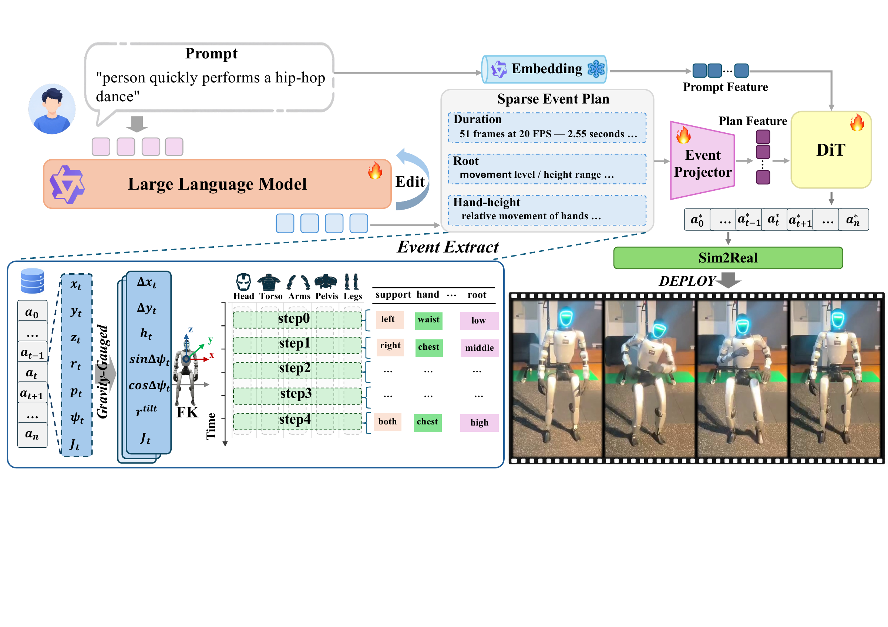
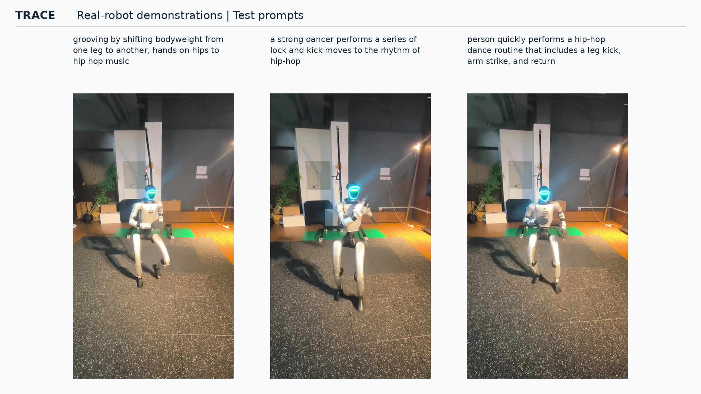

# TRACE

**Typed Reference-Aware Conversational Editing for Humanoid Motion Diffusion**

[Paper](https://arxiv.org/abs/2610.21515) · [PDF](https://arxiv.org/pdf/2610.21515) · [Models](https://modelscope.cn/models/kangzejian/TRACE) · [Inference assets](https://modelscope.cn/datasets/kangzejian/TRACE-Inference-Assets) · [Training](docs/TRAINING.md)

TRACE generates and edits Unitree G1 humanoid motion from language. An LLM predicts duration and sparse motion events; a diffusion Transformer combines this time-aligned Plan with the original text to generate a continuous trajectory. Reference-aware editing changes selected motion components while preserving local joint rotations outside the editing scope.



Motion-derived events supervise the language planner during training. At inference, the planner predicts events from text without access to a target motion. [Method details](docs/PAPER_OVERVIEW.md) · [Figure PDF](media/method.pdf)

## Real-robot demonstrations

[](media/real_robot_demo.mp4)

[Watch the video](media/real_robot_demo.mp4): jumping-jack editing, in-the-wild instructions, and dance examples. Physical execution uses a downstream controller.

## Installation

Linux, Python 3.10–3.12, and an NVIDIA GPU are recommended. The default environment uses PyTorch 2.11.0 with CUDA 12.8 wheels.

```bash
git clone https://github.com/Multimodal-Perception-Action/TRACE.git
cd TRACE
TRACE_PYTHON=python3.10 bash install.sh
```

Use an absolute interpreter path if `python3.10` is not on `PATH`. The installer creates a virtual environment without changing system Python. See [installation and offline usage](docs/INSTALL.md) for driver, rendering, and CPU options.

## Download models

```bash
# Only needed for private or access-controlled repositories:
.venv/bin/ms-hub login

.venv/bin/python tools/hub_assets.py download \
  --model-repo kangzejian/TRACE \
  --data-repo kangzejian/TRACE-Inference-Assets
.venv/bin/python run.py --check-models
```

The downloader checks TRACE artifact sizes and SHA-256 hashes. It also obtains the language bases from the official `Qwen/Qwen3-4B-Instruct-2507` and `Qwen/Qwen3-Embedding-4B` repositories. Allow about 16 GB for those two bases, plus the TRACE weights and caches. [Model files and formats](docs/ARTIFACTS.md)

## Generate motion

```bash
bash run.sh \
  --text "A person walks forward at a steady pace." \
  --output outputs/walk
```

The output directory must be new. The default pipeline is:

`text → LLM Plan + text embedding → boundary-conditioned diffusion → smoothing → heel/toe refinement → SPS + video`

- `motion_final.sps`: final 20 FPS motion for downstream use.
- `motion_raw.sps`: diffusion output before postprocessing.
- `pose35_final.npy`, `motion_final_qpos.npz`: array exports.
- `motion_smoothed.mp4`, `preview.png`, `index.html`: visualization of the final motion; the video filename is retained for compatibility.

Useful options:

- `--boundary free`: use the same boundary-capable model without start/end constraints.
- `--boundary none`: use the original generator without boundary conditioning.
- `--contact-refine none`: disable contact refinement; smoothing remains enabled.
- `--device cuda:0 --render-device 0`: select the inference and rendering GPU.
- `--skip-render`: export motion without rendering.

### Custom start and end poses

```bash
bash run.sh \
  --text "A person stands and waves the right hand." \
  --generator-checkpoint models/generator_boundary.pt \
  --start-ref start.sps --start-frame 0 \
  --end-ref end.sps --end-frame 0 \
  --output outputs/custom_idle
```

Start and end poses can come from different files. Compatible generation checkpoints can be selected independently of the references. [Reference formats and checkpoint compatibility](docs/REFERENCES_AND_EDITING.md)

## Edit motion

```bash
.venv/bin/python edit.py \
  --source outputs/walk/motion_final.sps \
  --instruction "Raise the right hand by 8 cm during the middle half." \
  --output outputs/hand_edit
```

The dedicated editor supports relative left/right hand-height edits up to 10 cm on 20 FPS motions of at most 104 frames. It uses its own checkpoint and language adapter. Outputs include `motion_edited.sps`, the interpreted request, the edit mask, and before/after videos. Editing applies reference projection without post-smoothing or IK.

An experimental generator-based editing path reuses `generator_boundary.pt` for source-noised, masked denoising with a revised caption and Plan. Its body scope is supplied explicitly. See [editing examples and supported scopes](docs/REFERENCES_AND_EDITING.md).

## Training and data

[Training guide](docs/TRAINING.md) covers data preparation, event supervision, language-planner training, diffusion training, boundary fine-tuning, and the independent editor. [Dataset guide](docs/DATA.md) explains the filename-only BONES-SEED V5 split format and how to match it to locally obtained data. The repository provides the training recipe and configuration; standalone generator/editor training entry points are not yet included.

Obtain motion files and annotations from the dataset provider under its license. Split lists contain filenames only, with no motion arrays, captions, or actor metadata.

The paper's V5 split lists are included: [train](splits/bones_seed_v5/train.jsonl) (84,287), [validation](splits/bones_seed_v5/val.jsonl) (13,293), and [test](splits/bones_seed_v5/test.jsonl) (13,302). See [split usage](splits/bones_seed_v5/README.md) to match these filenames to your local data.

## Tests

```bash
.venv/bin/python -m unittest discover -s tests -v
```

## License

TRACE code and project-owned released artifacts use [Apache-2.0](LICENSE). Third-party components retain their own licenses; see [THIRD_PARTY_NOTICES.md](THIRD_PARTY_NOTICES.md). BONES-SEED is provided by [Bones Studio](https://bones.studio/) under its dataset agreement and is not relicensed by TRACE.

The outputs are flat-ground kinematic references. Robot execution requires a separately validated tracking controller.
