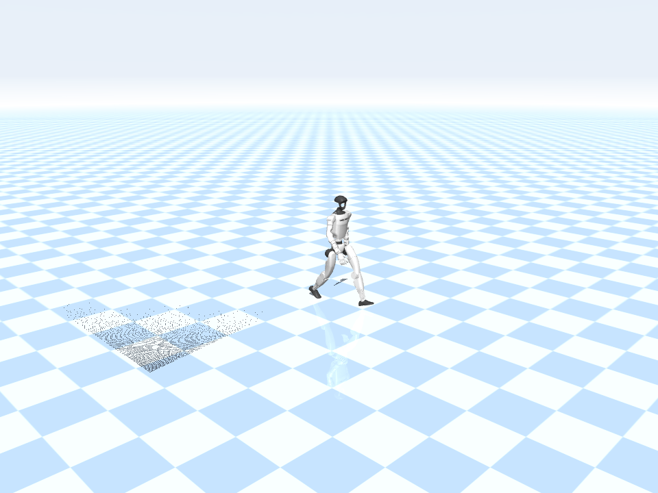
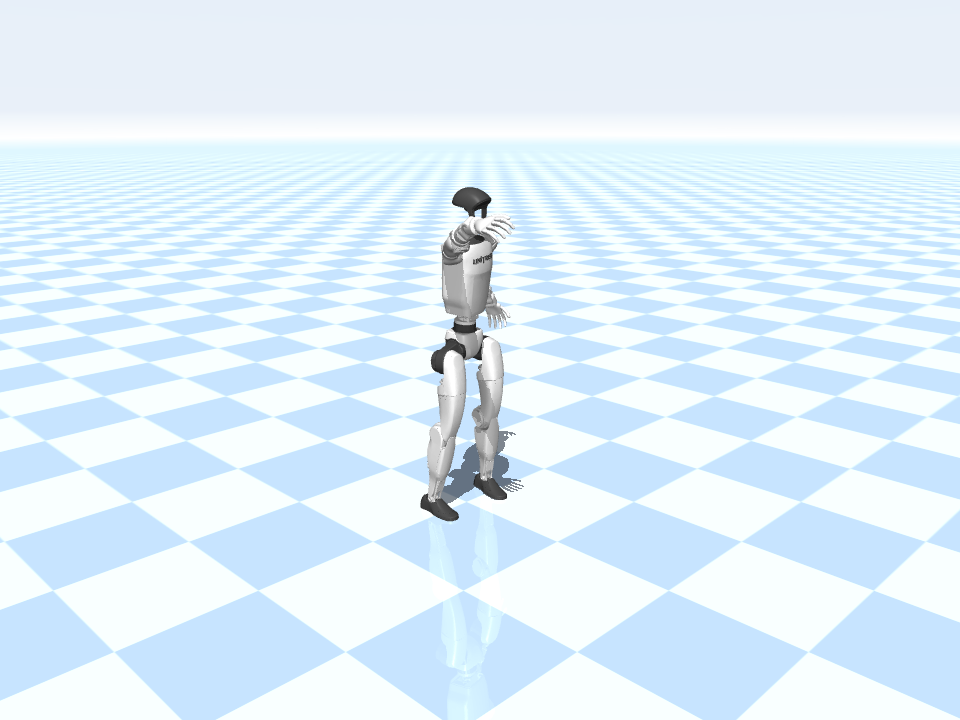
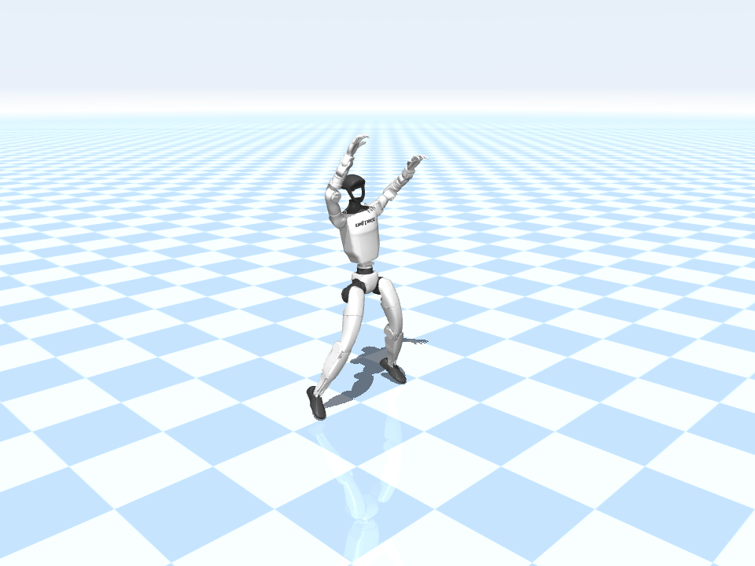

# TRACE

**Typed Reference-Aware Conversational Editing for Humanoid Motion Diffusion**

[Code](https://github.com/Multimodal-Perception-Action/TRACE) · [ModelScope weights](https://modelscope.cn/models/kangzejian/TRACE) · [Inference assets](https://modelscope.cn/datasets/kangzejian/TRACE-Inference-Assets) · [Paper overview](docs/PAPER_OVERVIEW.md) · [中文说明](docs/发布说明.md)

TRACE connects language to measurable motion structure for Unitree G1 humanoids. A language model predicts duration and sparse support, root-motion, and hand-height events. A diffusion Transformer combines the resulting time-aligned Plan with the original text to generate continuous, gravity-referenced motion. The paper also studies source-relative conversational editing with typed goals and reference preservation.

This repository releases the **text-to-motion generation pathway** with portable installation, standing start/end constraints, contact refinement, SPS export, and rendering. The paper's separate conversational editor and training pipeline are not included. See the [paper overview](docs/PAPER_OVERVIEW.md) for the distinction between paper coverage and release coverage.

## Method


The figure shows motion-derived event supervision during training and language-conditioned generation at inference. GT motion is not required at inference. The robot-control stack shown in the paper figure is not included in this release. [PDF figure](media/method.pdf).

## Example results

Click a preview to open its MP4. These are generated kinematic demonstrations with standing boundaries, smoothing, and heel/toe refinement; they are not raw benchmark outputs or controller rollouts.

| Walking | Waving | Jumping jack |
| --- | --- | --- |
| [](media/walk.mp4) | [](media/wave.mp4) | [](media/jump.mp4) |
| A person walks forward at a steady pace. | A person stands and waves the right hand. | Perform a jumping jack. |

## Inference workflow

Input an English motion instruction and obtain a 20 FPS G1 kinematic reference, SPS files, joint arrays, a video, and a local preview page. The default workflow is:

`text → LLM duration/events → text embedding → boundary-conditioned diffusion → smoothing → heel/toe four-point refinement → SPS + preview`

The contact labels are geometric postprocessing estimates with a Plan prior, not a newly trained heel/toe label predictor. The root translation and leg joints are optimized jointly over time. Root orientation and upper-body joint angles remain unchanged. Standing boundary frames are protected throughout refinement.

This is an **inference release**, not a complete training reproduction. It does not include third-party training/test data, private experiment reports, user-study material, or a robot controller. Current limitations include flat-ground assumptions, imperfect compound-action semantics, and possible trade-offs between slip, penetration, and motion preservation. The outputs are kinematic references, not guarantees of dynamic balance or safe robot execution.

## Layout

```text
TRACE/
  run.py, run.sh, install.sh       inference and environment setup
  trace_core/                     planner, diffusion, smoothing, contact refinement
  render.py, assets/              G1 rendering and third-party notices
  tests/                          offline tests
  tools/hub_assets.py             ModelScope download / guarded upload
  tools/release_check.py           integrity and release-content checks
  release_manifest.json           exact inference artifact hashes and layout
  publish/model/                  local model upload candidate; ignored by Git
  publish/data/                   local inference-resource candidate; ignored by Git
  docs/                           installation, publication, artifact formats
  media/                          paper method figure and generated MP4 examples
```

The `publish/` directory is a local upload staging area excluded from Git and code archives. Qwen base weights are not duplicated there; clients download them from official ModelScope repositories. The data repository contains only inference resources, not training or test motion data.

## Installation

Use Linux with Python 3.10–3.12. The reference runtime uses Python 3.10, PyTorch 2.11.0 and CUDA 12.8 wheels. Other machines must validate NVIDIA driver compatibility. The installer creates its own virtual environment and can bootstrap pip without system `ensurepip`.

```bash
git clone https://github.com/Multimodal-Perception-Action/TRACE.git
cd TRACE
TRACE_PYTHON=python3.10 bash install.sh
```

Use `TRACE_PYTHON=/absolute/path/to/python` if that executable is not on `PATH`. To select CPU wheels, set `TRACE_TORCH_INDEX=https://download.pytorch.org/whl/cpu`; CPU inference is slow. EGL rendering needs host graphics libraries and a working NVIDIA driver. For headless Debian/Ubuntu, an administrator may need to install `libegl1 libgl1 libglib2.0-0`. `--skip-render` disables graphics rendering but contact IK still needs MuJoCo.

See [INSTALL.md](docs/INSTALL.md) for the separate asset-download step. Installation does not require checkpoint files and does not silently download them.

## Download artifacts from ModelScope

Use the companion ModelScope repositories after their release is available. Login is needed only for private or access-controlled resources:

```bash
.venv/bin/ms-hub login
.venv/bin/python tools/hub_assets.py download \
  --model-repo kangzejian/TRACE \
  --data-repo kangzejian/TRACE-Inference-Assets
.venv/bin/python run.py --check-models
```

Downloads use manifest filenames and SHA-256 checks. The original Qwen planner and embedding snapshots come from `Qwen/Qwen3-4B-Instruct-2507` and `Qwen/Qwen3-Embedding-4B`. The default `master` upstream revision follows the provider; pin tested immutable revisions in `release_manifest.json` before final publication. Custom TRACE artifacts are verified against exact hashes; this is not a byte-identical guarantee for unpinned upstream bases.

For already authorized offline use, place your own files in the `models/` paths described in [ARTIFACTS.md](docs/ARTIFACTS.md). No public upload is required for local execution.

## End-to-end inference

```bash
bash run.sh \
  --text "A person walks forward at a steady pace." \
  --output outputs/walk
```

The directory must be new. Defaults are standing boundaries, DDIM 50, CFG 2.5, and `--contact-refine heel_toe`. Change `--device cuda:0` and `--render-device 0` for your GPU. To use another environment, set `TRACE_PYTHON` to its interpreter.

- `motion_final.sps`: final smoothed and contact-refined motion; use this downstream.
- `pose35_final.npy`, `motion_final_qpos.npz`: equivalent array formats.
- `motion_smoothed.sps`: intermediate before contact refinement.
- `motion_smoothed.mp4`, `preview.png`, `index.html`: visualization of **final** SPS; legacy video filename retained for compatibility.
- `contact_refine_report.json`: solver settings, label layout, timing, preservation checks.

Options: `--contact-refine joint` uses the earlier center-point solver; `--contact-refine none` uses smoothing only; `--boundary none` uses the original generator without standing boundary conditioning. These are engineering alternatives, not a claim that one postprocessor dominates all metrics.

## Tests and publication

```bash
.venv/bin/python -m unittest discover -s tests -v
python3 tools/release_check.py
python3 tools/hub_assets.py upload \
  --model-repo kangzejian/TRACE \
  --data-repo kangzejian/TRACE-Inference-Assets
```

Upload defaults to a dry run. Execution is deliberately blocked until the release manifest records owner approval and `--execute` is supplied. This safety switch does not grant legal permission. Do not include credentials in commands, source files, model cards, or examples; use interactive ModelScope login. Public sharing of output directories requires reviewing generated request/render metadata for local paths.

## Licensing and attribution

Project-owned code and released checkpoints/inference assets are distributed under [Apache-2.0](LICENSE). Third-party components retain their own licenses; see [licensing notes](LICENSING.md) and [THIRD_PARTY_NOTICES.md](THIRD_PARTY_NOTICES.md). The project owner has confirmed permission to publicly distribute the released artifacts. This repository does not grant a license to the underlying training dataset.

Training data includes Motion Data by [Bones Studio](https://bones.studio/). Use of the underlying dataset is subject to the BONES Motion Capture Dataset License Agreement. Raw/retargeted motion, original captions, splits and supervision caches are not included.

[中文发布说明](docs/发布说明.md)
